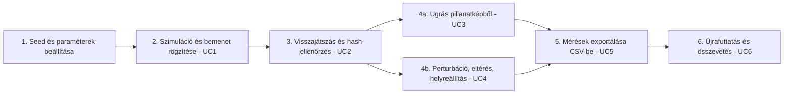
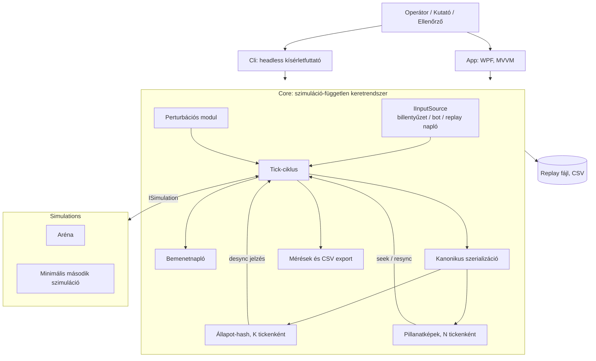

# Determinisztikus visszajátszás és állapotszinkronizáció játékokban

Kapcsolódó projektoutline: [01-project-outline.md](./01-project-outline.md)

## 1. Szereplők és jogosultságok

| Szerep | Igény | Felelősség / hozzáférés |
| --- | --- | --- |
| Operátor (Operator) | Az aréna-szimuláció irányítása, a futás rögzítése, majd visszajátszása és az idővonalon való mozgás | Rögzítést és visszajátszást indít, billentyűzettel irányítja a játékos-entitást, tetszőleges tickre ugrik. |
| Kutató (Researcher) | A determinizmus korlátainak, a pillanatképek hatásának és a helyreállításnak a kísérleti vizsgálata | Beállítja a kísérleti paramétereket, perturbációt injektál, futtatja a méréseket (grafikus felületen vagy headless módban), exportálja az eredményeket. |
| Ellenőrző (Verifier) | Az eredmények és a visszajátszás önálló ellenőrzése, a kísérletek reprodukálása | Csak olvasási jellegű használat: betölti a replay fájlt és megtekinti a visszajátszást, a repóból a megadott konfigurációval újrafuttatja a kísérletet, és összeveti az eredményt a közölt CSV-vel. Nem módosítja a rendszert. |

A rendszer egyfelhasználós asztali alkalmazás, nincs bejelentkezés és nincs jogosultságkezelés. A szerepek a használat céljában különböznek, az Ellenőrző jogosultsága pedig nem technikai korlát, hanem a használat jellege (csak megtekint és újrafuttat, nem szerkeszt).

Szakkifejezések: a dokumentum magyar nyelvű, a fogalmak első előfordulásánál zárójelben az angol megfelelő áll, mert a megvalósításban ezek az azonosítók.

| Magyar | Angol (kódbeli név) | Jelentés |
| --- | --- | --- |
| Tick (időlépés) | `Tick` | A szimuláció egy fix lépése. |
| Pillanatkép | `Snapshot` | A teljes állapot (a PRNG állapotával együtt) mentése adott tickben. |
| Ellenőrzőpont | `Checkpoint` | Olyan tick, ahol az állapot-hash rögzítése és ellenőrzése történik. |
| Eltérés | `Desync` | A visszajátszott állapot eltér a rögzítettől. |
| Helyreállítás | `Resync` | Visszaállás egy pillanatképre és az állapot újraszámolása eltérés után. |
| Ugrás | `Seek` | Ugrás a visszajátszás adott tickjére. |
| Perturbáció | `Perturbation` | Szándékosan bevitt hiba az eltérés-felismerés és helyreállítás vizsgálatához. |
| Visszajátszás | `Replay` | A futás újra előállítása a rögzített bemenetekből. |
| Seed (kezdőérték) | `Seed` | A PRNG kezdőértéke; a konfigurációval együtt ebből áll elő a kezdőállapot. |
| Álvéletlenszám-generátor | `PRNG` | Képlet alapján véletlennek látszó, de determinisztikus számsorozatot ad; belső állapota menthető. |
| Bot | `Bot` | Seedelt, szkriptelt bemenetgenerátor a kísérletekhez. |

**Tick-konvenció.** S₀ a kezdőállapot (`Init(config, seed)`), és Sₜ = `Step(Sₜ₋₁, inputₜ)`. A T. tick bemenete a T. lépés előtt érvényesül; a T. tickhez tartozó pillanatkép és állapot-hash a T. lépés **után** értendő (az S_T állapot). Ha egy tickhez nincs naplóbejegyzés, a bemenet semleges (nincs lenyomott billentyű). Ha egy tickhez több esemény tartozik, azok a naplóbeli sorrendben, egyetlen bemenetté összevonva érvényesülnek. A `Seek(T)` a T-nél nem későbbi legutolsó pillanatkép tickjétől (s) az s+1…T tickeket számolja újra, vagyis egyetlen bemenetet sem alkalmaz kétszer.

## 2. Use case-ek / user storyk

### UC1 – Szimuláció rögzítése

- **Szereplő:** Operátor (Operator)
- **Előfeltétel:** A konfiguráció (N, K, bemeneti forrás) be van állítva. A seedet a szereplő megadja, vagy a rendszer véletlenszerűen sorsol és a replay fejlécébe menti.
- **Fő folyamat:**
  1. A szereplő Record módban elindít egy új szimulációt. A bemenet forrása a billentyűzet (Operátor) vagy egy szkriptelt, seedelt bot (kísérletek).
  2. A rendszer a konfigurációból és a seedből inicializálja a világállapotot és a PRNG-t, a 0. tickről pillanatképet készít, majd fix időlépésenként (tick) futtatja a szimulációt.
  3. A szereplő billentyűzettel irányítja a játékos-entitást.
  4. A rendszer minden bemenetet a tick sorszámával együtt naplóz.
  5. A rendszer N tickenként pillanatképet, K tickenként állapot-hasht (ellenőrzőpontot) rögzít.
  6. A szereplő leállítja a rögzítést (bot esetén a megadott tickszám elérésekor leáll), a rendszer replay fájlba menti az adatokat, a fájl törzsére számított integritás-hash-sel együtt.
- **Alternatív / hibafolyamatok:** Ha egy tickben nincs bemenet, nem keletkezik naplóbejegyzés, a szimuláció ettől függetlenül lép. A bot saját PRNG-t használ, amely független a szimuláció PRNG-jétől. Ha a fájl mentése sikertelen, a rendszer hibát jelez, és a memóriabeli replay megmarad.
- **Utófeltétel:** Létezik egy replay fájl (fejléc: formátumverzió, szimulációs kompatibilitás-azonosító, seed, konfiguráció, numerikus mód, az utolsó tick sorszáma; bemenetnapló, hash-ellenőrzőpontok a záró ellenőrzőponttal együtt, pillanatképek, integritás-hash).

### UC2 – Visszajátszás és ellenőrzés

- **Szereplő:** Operátor (Operator)
- **Előfeltétel:** Be van töltve egy érvényes replay fájl.
- **Fő folyamat:**
  1. A szereplő elindítja a visszajátszást. A rendszer előbb ellenőrzi a fájl integritás-hash-ét.
  2. A rendszer a fejlécből inicializálja a szimulációt, és a naplózott bemeneteket a rögzített tickekben alkalmazza.
  3. Minden ellenőrzőpontnál a rendszer kiszámítja az aktuális állapot-hasht, és összeveti a replay fájlban tároltal.
  4. A rendszer a futás végén kiírja az eredményt: egyezés vagy az első eltérés tickje.
  5. A szereplő a visszajátszást bármikor szüneteltetheti, folytathatja, és választhat sebességet (valós idejű vagy maximális; a 2x és 4x *Ajánlott*, FR-C7). Egy tickkel előre vagy hátra lépni *Ajánlott* (FR-C4).
- **Alternatív / hibafolyamatok:** Ha a replay fájl formátumverziója ismeretlen, vagy az integritás-hash nem egyezik (sérült fájl), a rendszer nem indítja el a visszajátszást, és hibaüzenetet ad. Így a sérült fájl nem téveszthető össze szimulációs eltéréssel (desync). Eltérés (desync) esetén a rendszer jelzi és naplózza az eltérést; a további viselkedést a konfigurált eltéréskezelési mód adja (három kizáró mód: **Folytatás**, **Megállás**, **Automatikus helyreállítás**). A visszajátszás (UC2) alapértelmezett módja a Folytatás.
- **Utófeltétel:** A visszajátszás eredménye (egyezik / eltér) naplózva van.

### UC3 – Ugrás a visszajátszás adott pontjára (seeking)

- **Szereplő:** Operátor (Operator)
- **Előfeltétel:** Be van töltve egy replay fájl.
- **Fő folyamat:**
  1. A szereplő az idővonalon kiválaszt egy T cél-ticket.
  2. A rendszer megkeresi a T-nél nem későbbi legutolsó pillanatképet, és visszaállítja belőle az állapotot (PRNG állapottal együtt).
  3. A rendszer a pillanatkép tickjét (s) követő s+1…T tickeket megjelenítés nélkül újraszámolja a naplózott bemenetekkel.
  4. A rendszer megjeleníti a T. tick állapotát, a szereplő onnan folytathatja a lejátszást.
- **Alternatív / hibafolyamatok:** A sérült replay fájlt a rendszer már betöltéskor elutasítja (integritás-hash). Ha ennek ellenére a visszaállított pillanatkép nem dekódolható, vagy a hash-e nem egyezik a mentett hash-sel, a rendszer az előző pillanatképre esik vissza, és az eseményt naplózza (*Ajánlott*, FR-D4). Ha T a replay hosszán túl van, a felületen az idővonal ezt nem engedi, programozott (parancssori) hívásnál a rendszer hibát ad.
- **Utófeltétel:** A megjelenített állapot a T. tick állapota; ha T ellenőrzőpont, az állapot-hash megegyezik a rögzítéskor tárolt hash-sel.

### UC4 – Perturbáció, eltérés érzékelése és helyreállítás

- **Szereplő:** Kutató (Researcher)
- **Előfeltétel:** Visszajátszás fut, az állapot-ellenőrzés be van kapcsolva, az eltéréskezelési mód Automatikus helyreállítás (a helyreállítási kísérlet alapértelmezett módja). A perturbáció típusa és időpontja meg van adva: a szereplő adott ticket választ, vagy véletlenszerű időpontot kér, amelyet a rendszer egy külön, seedelt PRNG-ből sorsol (így a kísérlet reprodukálható).
- **Fő folyamat:**
  1. A szereplő perturbációt injektál. A típusok: állapotzaj (egy előre kijelölt állapotmező módosítása rögzített, érvényes tartományon belüli értékre; nem tetszőleges bitátfordítás, így nem keletkezik `NaN` vagy végtelen) és elcsúsztatott bemenet (egy előre kiválasztott, hatásos, nem az utolsó tickbeli bemenet eltolása a t. tickről a t+1. tickre) *Kötelező*; kihagyott bemenet és numerikus eltérés (a lépés apró lebegőpontos hibával számol) *Ajánlott*. A sorrend egy tickben: bemenet → `Step` → állapotperturbáció → hash. Az injektálás tickje az első módosított tick.
  2. A rendszer az első olyan ellenőrzőpontnál, ahol az eltérés még fennáll, desync-et észlel, naplózza a tick sorszámát és jelzi a felületen. A késleltetést az első módosított ticktől méri. A „nem észlelt” kimenet jelentése: a záró ellenőrzőpontig egyetlen ellenőrzőponton sem volt hash-eltérés (a zavarás hatástalan vagy átmeneti volt); a rendszer ezt külön naplózza. A futás végén záró ellenőrzőpont van.
  3. Észleléskor a rendszer az észlelés tickjénél megállítja a léptetést, és az **eredeti replay** legutóbbi, az észlelés tickje előtti pillanatképéből újraszámolja az állapotot az észlelés tickjéig, az eredeti naplóval, perturbáció nélkül. Az MVP-ben a helyreállítás automatikus; a kézi indítás (gombbal) *Ajánlott* (FR-D9).
  4. A rendszer az észlelés tickjén ellenőrzi, hogy az állapot-hash megegyezik az eredeti replay hash-ével. Siker esetén az aktív állapotot lecseréli a helyreállítottra, az adott perturbáció minden függőben maradt hatását törli (például a későbbi tickre eltolt bemenetet), és a futás a következő tickről kizárólag az eredeti naplóval folytatódik; naplózza a helyreállítás idejét és az újraszámolt tickek számát.
- **Alternatív / hibafolyamatok:** Folytatás vagy Megállás módban a rendszer nem állít helyre: az előbbi folytatja a futást, az utóbbi az észlelésnél leáll, az eltérés mindkét esetben jelezve marad. Ha a helyreállítás után a hash nem egyezik, a rendszer a próbálkozást megszakítja, sikertelenként naplózza, és a futás megállított állapotban marad; a hibát a pontos eltérő tick keresése (FR-D8) tovább vizsgálja.
- **Utófeltétel:** A helyreállítás sikeres, ha az észlelés tickjén a hash egyezik az eredeti replay hash-ével, az aktív állapot ki van cserélve, és a folytatás a záró ellenőrzőpontig az eredeti replay hash-eivel egyező hash-eket ad; egyébként a sikertelen helyreállítás naplózva van.

### UC5 – Kísérlet futtatása és mérési adatok exportálása

- **Szereplő:** Kutató (Researcher)
- **Előfeltétel:** A kísérleti konfiguráció (szimuláció hossza, seed, bot seed, N, K, numerikus mód, perturbáció típusa és időpontja, ismétlések száma, alapértelmezetten 5) meg van adva.
- **Fő folyamat:**
  1. A szereplő elindítja a kísérletet (headless parancssorból vagy a felületről).
  2. A rendszer egy bemelegítő futás után, release módban, megjelenítés nélkül, a konfiguráció szerint bottal rögzíti, majd visszajátssza a futást, közben méri a költségeket. A mérést az ismétlések számának megfelelően megismétli.
  3. A rendszer a mérési eredményeket CSV fájlba exportálja: a konfigurációt, a környezetet (OS, CPU, .NET verzió, keretrendszer-verzió), a helyességi mutatókat, a tárhelymutatókat (köztük a minden tickben teljes állapotot mentő referenciaméretet és a csökkenés arányát) és az időmutatókat (az időkre medián, minimum, maximum).
- **Alternatív / hibafolyamatok:** Ha a konfiguráció érvénytelen (például N ≤ 0), a rendszer a futtatás előtt hibaüzenetet ad.
- **Utófeltétel:** A CSV tartalmazza a futás paramétereit és mérőszámait. A determinisztikus oszlopok (hash, méretek, eltérő tick, észlelési késleltetés) azonos build, támogatott környezet és futtatási profil mellett azonosak; más környezetben az egyezés kísérleti eredmény. Az idő oszlopok gépfüggők.

### UC6 – Kísérlet reprodukálása és eredményének ellenőrzése

- **Szereplő:** Ellenőrző (Verifier)
- **Előfeltétel:** Az Ellenőrző hozzáfér a repóhoz, a közölt konfigurációs fájlhoz és a közölt CSV-hez.
- **Fő folyamat:**
  1. Az Ellenőrző a repóból letölti és lefordítja a kódot.
  2. Egyetlen paranccsal újrafuttatja a közölt konfigurációt.
  3. A rendszer összeveti az új futás determinisztikus oszlopait a közölt CSV-vel, és jelzi az egyezést vagy az eltérő oszlopokat (*Ajánlott*, FR-F5; az MVP-ben az Ellenőrző az oszlopokat kézzel veti össze).
  4. Az Ellenőrző szükség esetén betölti a mellékelt replay fájlt a felületen, és megtekinti a visszajátszást.
- **Alternatív / hibafolyamatok:** Ha egy determinisztikus oszlop eltér, az Ellenőrző ezt az oszlopok kézi összevetésével állapítja meg; az automatikus jelzés (melyik oszlop) *Ajánlott* (FR-F5). Az idő oszlopok eltérése nem hiba.
- **Utófeltétel:** Az Ellenőrző tudja, hogy a közölt eredmény reprodukálható-e a saját környezetében.

## 3. Funkcionális követelmények

Az azonosító betűje a csoportot jelöli: **A** szimuláció és véletlen, **B** rögzítés és fájl, **C** visszajátszás és vezérlés, **D** ellenőrzés, eltérés, helyreállítás, **E** perturbáció, **F** mérés és reprodukálhatóság, **G** felület.

| Követelmény | Elfogadási kritérium | Prioritás |
| --- | --- | --- |
| **FR-A1** – A rendszer fix időlépésű (tick-alapú) szimulációs ciklust futtat, amely független a megjelenítés képkockasebességétől. | Adott azonos seed és bemenetsorozat esetén, amikor a szimulációt különböző megjelenítési sebességgel (vagy megjelenítés nélkül) futtatjuk, ugyanaz az állapot-hash keletkezik ugyanazon tickben. | Kötelező |
| **FR-A2** – A rendszer seedelhető, állapotmenthető véletlenszám-generátort használ (rögzített algoritmus, teljes belső állapot). | Adott seed esetén a generátor mindig ugyanazt a sorozatot adja (ismert tesztvektorral egyezően), és a belső állapotból visszaállítva onnan folytatja a sorozatot, ahol megszakadt. | Kötelező |
| **FR-A3** – A rendszer 2D aréna-szimulációt futtat referenciaimplementációként (mozgás, ütközés, játékosbemenet, seedelt véletlen esemény). | Adott játékos-bemenetre a játékos-entitás a szabályok szerint mozog (például falnak lépve nem változik a pozíciója), az entitások ütközése és a seedelt véletlen események (például tárgyak megjelenése) kézzel kiszámolható, reprodukálható módon zajlanak. | Kötelező |
| **FR-A4** – A seed megadható, vagy a rendszer sorsol és a replay fejlécébe menti. | Adott megadott seednél ugyanaz a kezdőállapot jön létre; sorsolt seednél a fejlécből a futás reprodukálható. | Kötelező |
| **FR-A5** – A visszajátszó keretrendszer szimuláció-független: a szimulációt kizárólag interfészen át éri el, az aréna típusait nem hivatkozza. | Adott a `Core` projekt, amikor az aréna nélkül lefordítjuk, hiba nélkül lefordul, és a keretrendszer-tesztek egy tesztszimulációval lefutnak. | Kötelező |
| **FR-A6** – A szimuláció numerikus módja választható (`double` és fixpontos egész). | Adott azonos bemenetsorozatnál mindkét mód külön-külön reprodukálható, a méréseknél az eredmény módonként összehasonlítható. | Ajánlott |
| **FR-A7** – A keretrendszer az aréna mellett legalább egy minimális második szimulációval is működik. | Adott a második (egyszerű) szimuláció esetén a rögzítés, visszajátszás, ugrás és eltérés-felismerés ugyanazzal a keretrendszerrel, módosítás nélkül működik. | Ajánlott |
| **FR-B1** – A bemenet forrása cserélhető (billentyűzet, szkriptelt bot, replay napló). | Adott seedelt bot és konfiguráció mellett kétszer rögzítve azonos bemenetnapló keletkezik; a bot nem használja a szimuláció PRNG-jét. | Kötelező |
| **FR-B2** – A rendszer a bemeneteket tick-sorszámhoz kötve rögzíti; a bemenet nélküli tick semleges bemenetet jelent. | Adott rögzítésnél minden bemenet a tick sorszámával kerül a naplóba, és a napló a replay fájlba menthető; az üres tickek nem generálnak bejegyzést, de a fájl tárolja az utolsó tick sorszámát. | Kötelező |
| **FR-B3** – A replay fájl fejléce tartalmazza a formátumverziót, a szimulációs kompatibilitás-azonosítót, a seedet, a szimuláció konfigurációját és a numerikus módot. | Adott replay fájlnál a fejléc az említett adatokat tartalmazza; ismeretlen formátumverziójú vagy eltérő kompatibilitás-azonosítójú fájlt a rendszer érthető hibával elutasít. | Kötelező |
| **FR-B4** – A replay fájl integritás-hash-t tartalmaz, amelyet betöltéskor ellenőriz a rendszer. | Adott egy bájtnyira módosított fájl esetén a betöltés hibával leáll, és ez megkülönböztethető a szimulációs eltéréstől. | Kötelező |
| **FR-B5** – A replay fájl emberi szemmel is vizsgálható formában (JSON) exportálható és visszaolvasható. | Adott replay fájlnál az exportált JSON ember által olvasható, és visszaolvasva ugyanazt a replayt adja. | Lehetséges |
| **FR-C1** – A rendszer a rögzített bemenetekből újra előállítja a futást. | Adott replay fájlnál, amikor a visszajátszás lefut, az állapot-hash minden ellenőrzőpontnál megegyezik a rögzítéskor tároltal. | Kötelező |
| **FR-C2** – A visszajátszás szüneteltethető, és valós idejű vagy maximális sebességgel futtatható. | Adott futó visszajátszásnál a szünet megállítja a tick-számlálót, a sebességváltás megváltoztatja a lépésszámot időegységenként; a maximális sebességnél megjelenítés nélkül fut. | Kötelező |
| **FR-C3** – A felhasználó a visszajátszás tetszőleges tickjére ugorhat. | Adott T ellenőrzőpont-tick esetén az ugrás után az állapot-hash megegyezik azzal, amit a 0. tickből folyamatos lejátszással kapnánk T-nél; pillanatkép-tickre és nem pillanatkép-tickre is az S_T állapotot adja, amely megegyezik a folyamatos futás állapotával. | Kötelező |
| **FR-C4** – A visszajátszásban egy tickkel előre és hátra lehet lépni, hátrafelé ismételten is. | Adott T tickből a hátralépés az ugrás szabályai szerint (`Seek(T-1)`) a T-1. tick állapotát adja, amely megegyezik a folyamatos futás állapotával; a művelet többször egymás után is használható. | Ajánlott |
| **FR-C5** – A hátrafelé lépésekhez a rendszer gyorsítótárat használhat, és folyamatos hátrafelé lejátszás is elérhető. | Adott gyorsítótár mellett az ablakon belüli hátralépések mérhetően gyorsabbak, mint a gyorsítótár nélküliek; hátrafelé lejátszásnál a megjelenített állapotok megegyeznek a folyamatos futás állapotaival. | Lehetséges |
| **FR-C6** – A felhasználó egy ugrás után új bemenettel folytathatja a futást (elágazás). | Adott T tick utáni új bemenetnél a T utáni napló, pillanatképek és hash-ek érvénytelenítve vagy új ágként tárolva vannak, és az új ág reprodukálható. | Lehetséges |
| **FR-C7** – A visszajátszás 2x és 4x sebességgel is futtatható. | Adott 2x és 4x sebességnél a lépésszám időegységenként a valós idejű többszöröse. | Ajánlott |
| **FR-D1** – A rendszer az állapotot kanonikus bináris szerializáció feletti hash-sel ellenőrzi (a hash valószínűségi eltérésjelző, nem bizonyítja a bitazonosságot). | Adott két azonos állapot esetén a hash megegyezik; a teszt az állapot minden mezőjére kimutatja, hogy a mező módosítása megváltoztatja a kanonikus bájtfolyamot (mezőlefedettség), a hash-hez pedig ismert tesztvektorok tartoznak; a `Serialize` → `Deserialize` után a futás folytatása ugyanazt az eredményt adja; néhány ismert hash-vektor egyezik. | Kötelező |
| **FR-D2** – A rendszer az állapot-hasht K tickenként rögzíti és ellenőrzi (K konfigurálható); a futás utolsó tickjén mindig záró ellenőrzőpont van. | Adott K=1 mellett az első eltérő tick pontosan azonosítható, K>1 esetén a fennmaradó eltérés legfeljebb K tickkel később, az első érintett ellenőrzőpontnál észlelhető; a futás utolsó tickje mindig ellenőrzőpont. | Kötelező |
| **FR-D3** – A rendszer N tickenként pillanatképet készít (N konfigurálható), a 0. tickről mindig. | Adott N mellett a replay fájlban a pillanatképek tickjei N többszörösei (a 0. tickkel együtt), és mindegyik tartalmazza a PRNG állapotát is. | Kötelező |
| **FR-D4** – Minden pillanatkép tartalmazza a saját állapot-hash-ét, amelyet a rendszer betöltéskor ellenőriz (a sikeres fájl-integritásellenőrzés után). | Adott pillanatkép-dekódolási vagy -hash hiba esetén a betöltés hibát jelez, és a rendszer az előző pillanatképre esik vissza; a sérült fájlt már az FR-B4 elutasítja. | Ajánlott |
| **FR-D5** – A rendszer észleli az eltérést (desync) és megadja az első olyan ellenőrzőpont tickjét, ahol az eltérés még fennáll. | Adott perturbált futásnál, ahol az eltérés az ellenőrzőpontig fennmarad, az eltérés az első ilyen ellenőrzőpontnál jelzett; ha a záró ellenőrzőpontig egyetlen ellenőrzőponton sem volt hash-eltérés, a rendszer "nem észlelt" kimenetet naplóz. | Kötelező |
| **FR-D6** – Eltérés esetén a rendszer jelzi azt, és a konfigurált eltéréskezelési mód szerint jár el; a három mód kizárja egymást: Folytatás (alapértelmezett a visszajátszásnál), Megállás, Automatikus helyreállítás (FR-D7). | Adott észlelt eltérésnél Folytatás módban a futás tovább megy és az eltérés naplózódik; Megállás módban az első eltérésnél leáll; Automatikus helyreállítás módban az FR-D7 szerint jár el. Egyszerre csak egy mód aktív. | Kötelező |
| **FR-D7** – Automatikus helyreállítás módban a rendszer helyre tudja állítani az állapotot eltérés után: az észlelés tickjénél megáll, az eredeti replay legutóbbi, az észlelés tickje előtti pillanatképéből újraszámol az észlelés tickjéig perturbáció nélkül, sikeres hash-ellenőrzés után kicseréli az aktív állapotot, törli az adott perturbáció függőben maradt hatásait, és a következő tickről kizárólag az eredeti naplóval folytatja. | Adott észlelt eltérésnél az újraszámolt állapot hash-e az észlelés tickjén megegyezik az eredeti replay hash-ével, és a folytatás a záró ellenőrzőpontig az eredeti replay hash-eit adja; célzott eset: K=1, eltolás t → t+1, észlelés és helyreállítás t-nél, egyező hash t+1-nél is. Sikertelen helyreállításnál a rendszer ezt naplózza, az aktív állapotot nem cseréli le, és a futás megállított marad. | Kötelező |
| **FR-D9** – A helyreállítás kézzel, a felületről is indítható. | Adott észlelt eltérésnél a gomb ugyanazt a helyreállítást indítja, mint az automatikus mód. | Ajánlott |
| **FR-D8** – Eltérés után a rendszer az utolsó jó pillanatképtől tickenkénti összevetéssel megadja a pontos eltérő ticket. | Adott észlelt eltérésnél az eltért futás és egy perturbáció nélküli referencia-újrafuttatás tickenkénti hash-ei alapján a rendszer megadja az első eltérő ticket (K > 1 esetén is); ha ez nem lehetséges, az eltérő ellenőrzőpontot adja meg. | Ajánlott |
| **FR-E1** – A kutató perturbációt injektálhat adott vagy véletlenszerű (seedelt) tickben; a kötelező típusok az állapotzaj (egy előre kijelölt mező módosítása rögzített, érvényes értéktartományon belül) és az elcsúsztatott bemenet (egy előre kiválasztott, hatásos, nem utolsó tickbeli bemenet eltolása t → t+1). | Adott perturbáció típusnál a rendszer az injektálás tickjét (az első módosított tick) naplózza; a teszt ellenőrzi, hogy a perturbáció után a kanonikus állapot ténylegesen megváltozott, és a futás az injektálástól eltér a referenciától; azonos seed mellett a véletlen időpont megegyezik. | Kötelező |
| **FR-E2** – A perturbáció típusai között numerikus eltérés is választható. | Adott numerikus perturbációnál a lépés apró lebegőpontos hibával számol, és a futás a hibától eltér a referenciától. | Ajánlott |
| **FR-E3** – A perturbáció típusai között kihagyott bemenet is választható. | Adott hatásos bemenet kihagyásánál a rendszer naplózza az injektálás tickjét, és a futás a kihagyástól eltér a referenciától. | Ajánlott |
| **FR-F1** – A rendszer méri és CSV-be exportálja a helyességi, tárhely- és időmutatókat (köztük az ellenőrzési időt, az ugrási időt és a helyreállítási időt). | Adott kísérleti futás végén a CSV tartalmazza a konfigurációt, a környezetet (OS, CPU, .NET verzió, build) és az összes mérőszámot; az időkre az ismétlések mediánját, minimumát és maximumát; a determinisztikus oszlopok azonos build, támogatott környezet és futtatási profil mellett azonosak. | Kötelező |
| **FR-F2** – A rendszer a tárhelymérésnél kiszámítja a minden tickben teljes állapotot mentő referenciamódszer méretét és a csökkenés arányát. | Adott kísérleti futásnál a CSV tartalmazza a referenciaméretet (a 0…T tickek kanonikus állapotméreteinek összege) és a replay fájl teljes méretével számított arányt; a referencia nem készül el tényleges fájlként. | Kötelező |
| **FR-F3** – A rendszer parancssorból (headless módban) is futtatható kísérletekhez. | Adott konfigurációnál a grafikus felület nélkül is lefut a kísérlet és létrejön a CSV. | Kötelező |
| **FR-F4** – A közölt kísérletek a repóból egyetlen paranccsal újrafuttathatók. | Adott közölt konfigurációs fájlnál a parancs azonos build és támogatott környezet mellett ugyanazt a determinisztikus eredményt adja (hash-ek, tárhely), mint a közölt CSV; az időmérések eltérhetnek. | Kötelező |
| **FR-F5** – A rendszer automatikusan összeveti egy új futás determinisztikus oszlopait a közölt CSV-vel. | Adott közölt CSV és azonos konfiguráció mellett a rendszer egyezést jelez; egy módosított determinisztikus oszlopnál megnevezi az eltérő oszlopot; az idő oszlopokat nem tekinti hibának. | Ajánlott |
| **FR-F6** – A kísérletek a grafikus felületről is indíthatók. | Adott konfigurációnál a felületről indított kísérlet determinisztikus oszlopai megegyeznek a headless futás oszlopaival (az idő oszlopok eltérhetnek). | Ajánlott |
| **FR-G1** – Az idővonal jelöli a pillanatképeket, az ellenőrzőpontokat és az észlelt eltéréseket. | Adott replay betöltésekor az idővonalon láthatók a pillanatképek és ellenőrzőpontok tickjei; eltérés esetén az eltérő pont külön jelölt. | Ajánlott |
| **FR-G2** – A felület a referencia és az eltért állapotot egymásra vetítve (ghost nézet) mutatja. | Adott észlelt eltérésnél a felület mindkét állapotot megjeleníti; rögzített eltért pozíciónál a referencia és az eltért entitás a megfelelő koordinátán jelenik meg. | Lehetséges |

Prioritás: **Kötelező** = a végtermékhez szükséges; **Ajánlott** = fontos; **Lehetséges** = idő esetén opcionális.

### Hatókör

- **MVP (2. félév):** az összes **Kötelező** követelmény: egy aréna, egy numerikus mód (`double`), egy helyreállítási stratégia (FR-D7), két perturbációtípus (állapotzaj, elcsúsztatott bemenet), headless kísérletfuttatás CSV-vel és alap WPF-demó. Az **Ajánlott** és a **Lehetséges** elemek csak a kötelezők elkészülte után kerülnek sorra. Fejlesztési sorrend: headless rögzítés és visszajátszás → ugrás és helyreállítás → reprodukálható mérések → WPF.
- **Hatókörön kívül:** platformok közötti bitazonosság; hálózati játék és netcode; 3D megjelenítés és külső játékmotor integrációja; többszálú szimuláció; külső, kész játék adapterezése; kriptográfiai biztonságú hash.
- A use case-ek egyes lépései Ajánlott követelményekre épülnek, ezek nem az MVP részei: lépés vissza (FR-C4, UC2), 2x és 4x sebesség (FR-C7, UC2), pillanatkép-hash visszaesés (FR-D4, UC3), kihagyott bemenet és numerikus eltérés (FR-E3, FR-E2, UC4), kézi helyreállítás indítás (FR-D9, UC4), automatikus CSV-összevetés (FR-F5, UC6), kísérletindítás a felületről (FR-F6).

## 4. Üzleti szabályok és korlátok

| Szabály vagy korlát | Indoklás |
| --- | --- |
| A teljes világállapot minden tickben történő rögzítése nem lehet a visszajátszás elsődleges mechanizmusa. | A feladatkiírás kifejezett tiltása; a bemenet-alapú újraszámolás a projekt lényege. |
| A bemenetnapló marad a hiteles forrás: a hash-ellenőrzés és a pillanatkép csak gyorsítás és ellenőrzés, nem a replay helyettesítője. | Biztosítja, hogy a visszajátszás a bemenetekből újraszámolt futás marad. |
| A szimulációs magban tilos a rendszeridő (`DateTime`, `Stopwatch`), a megjelenítési képkockasebesség, a `System.Random`, a szálak közötti versenyhelyzet és a nem rögzített sorrendű gyűjtemények bejárása. | Ezek a nemdeterminizmus leggyakoribb forrásai; a mag csak a tick sorszámától, az állapottól és a naplózott bemenettől függhet. |
| Az entitások feldolgozási sorrendje és a hash bemenetének sorrendje rögzített (azonosító szerint növekvő). | A rendezetlen bejárás vagy szerializáció azonos állapotra is eltérő hash-t adhat. |
| A bemenet az adott tick szimulációs lépése előtt kerül alkalmazásra, és a naplóban tick szerint rendezett. | Egyértelmű sorrend nélkül a visszajátszás eltérő eredményt adhat. |
| A kanonikus szerializáció rögzített bájtsorrendet (little-endian) használ, kitöltés nélkül; a `double` érték a bitmintájával kerül be. A `NaN` és a `-0.0` kezelése egységes: a szimuláció állapotában nem fordulhat elő érvénytelen (`NaN`) érték, a `-0.0` pedig az állapothatáron (lépés után) `+0.0`-ra egységesül, így a mentett és visszatöltött állapot azonos viselkedésű. | Ezek nélkül azonos állapot is eltérő bájtsorozatot és hash-t adhat, vagy a visszatöltött állapot eltérően viselkedne. |
| Az állapot-hash valószínűségi eltérésjelző, nem bizonyítja a bitazonosságot. | Az XxHash64 ütközhet; a bitazonosságot a bájtfolyam közvetlen összehasonlítása bizonyítja, ahol erre szükség van. |
| Minden pillanatkép tartalmazza a PRNG teljes belső állapotát. | Enélkül a pillanatképből indított folytatás eltérne a folyamatos futástól. |
| A szkriptelt bot saját, seedelt PRNG-t használ, nem a szimulációét. | A bot döntései ne változtassák a szimuláció véletlensorozatát, és a bot naplója önmagában reprodukálható legyen. |
| A visszajátszó keretrendszer nem hivatkozhat az aréna típusaira, a szimulációt kizárólag az `ISimulation` interfészen át éri el. | Ez teszi a megoldást általánossá, és lehetővé teszi a második szimulációt (FR-A5, FR-A7). |
| A replay fájl fejlécének tartalmát az FR-B3 írja elő (formátumverzió, kompatibilitás-azonosító, seed, konfiguráció, numerikus mód). | Eltérő konfigurációval a visszajátszás nem reprodukálható; verzióellenőrzés nélkül sérült vagy régi fájl félrevezető eredményt adhat. |
| A sérült fájl (integritáshiba) és a szimulációs eltérés (desync) két külön hiba, külön jelzéssel; a sérült fájlt a rendszer mindig elutasítja. | Az első a tárolás, a második a futás hibája; összemosva a diagnózis félrevezető lenne. |
| A közölt kísérletek konfigurációja és seedje a repóban van, és futtatás után nem módosul. | Az Ellenőrző csak így tudja ugyanazt a kísérletet újrafuttatni (UC6). |
| A tick-konvenció az 1. fejezetben rögzített: Sₜ = `Step(Sₜ₋₁, inputₜ)`, a pillanatkép és a hash a lépés után értendő, az üres bemenet semleges. | Egyértelmű időzítés nélkül a `Seek` egytickes eltérést okozhat, vagy egy bemenetet kétszer alkalmazhat. |
| A visszajátszás csak azonos formátumverziójú és szimulációs kompatibilitás-azonosítójú fájlt fogad el. | Az olvasható fájl még nem jelenti, hogy az új szimuláció ugyanazokat a szabályokat használja. |
| A garantált determinizmus szintje: azonos build, azonos operációs rendszer és architektúra, azonos .NET futtatókörnyezet és dokumentált futtatási profil (Release, rögzített beállítások) mellett két külön folyamatban bájtszintű egyezés. Más hardveren, futtatókörnyezetben vagy Debug/Release között az egyezés kísérleti eredmény, nem elfogadási feltétel. | A platformok közötti bitazonosság a feladatkiírás szerint nem követelmény; a CPU-képességek és a JIT miatt a garancia határát a dolgozatban egyértelműen dokumentálni kell. |
| Titkos kulcs, token vagy személyes adat nem kerülhet a repóba. | A feladatkiírás előírása. |

## 5. Felhasználói felület és munkafolyamat

Az alkalmazás egyetlen főablakos WPF asztali program, két területtel és egy állapotsorral.

1. **Szimulációs tér és lejátszóvezérlő (bal oldal):** az aréna 2D nézete, alatta a lejátszóvezérlő (ugrás az elejére, lépés vissza, lejátszás/szünet, lépés előre, sebesség: 1x, 2x, 4x, max), a tick-számláló és az idővonal-csúszka az ugráshoz. Az idővonalon jelölve vannak a pillanatképek, az ellenőrzőpontok és az észlelt eltérések (FR-G1).
2. **Kísérleti és diagnosztikai panel (jobb oldal):** két fül. A **Kísérlet** fülön állítható a seed, N, K, a numerikus mód és a perturbáció típusa és ideje; a **Mérések** fülön élő mérőszámok (tárhely, hash-idő, ugrási idő), az eltérések naplója és a CSV-export.
3. **Állapotsor (alul):** az aktuális tick, az állapot-hash, a mód (rögzítés vagy visszajátszás) és az ellenőrzés állapota (egyezik / eltérés).

### Wireframe

```text
+------------------------------------------------------------------------------+
| Fájl  [Új | Megnyitás | Mentés | Export JSON]        Mód [Rögzítés|Visszajátszás] |
+---------------------------------------------+--------------------------------+
|                                             | [ Kísérlet ] [ Mérések ]       |
|                                             |                                |
|            ARÉNA NÉZET (2D)                 | Seed:        [ 12345 ] [Sorsol]|
|                                             | N (pillanatkép): [ 100 ]       |
|        o        #                           | K (ellenőrzés):  [ 10  ]       |
|             @        o                      | Numerikus mód:   (•)double ( )fix|
|                  #                          | Perturbáció:     [ állapotzaj v]|
|                                             | Időpont:  (•)tick [ 500 ] ( )seedelt|
|                                             | Eltérés: (•)folytat ( )megáll ( )helyreáll|
|                                             |                                |
|                                             | [ Futtatás ] [ Helyreállítás ] |
+---------------------------------------------+--------------------------------+
| |<  <|  [ ||/> ]  |>   Sebesség: 1x 2x 4x max       Tick: 0420 / 3000        |
| 0 |-----S------o--------S---X------------------------------------------| 3000|
|   S = pillanatkép   o = ellenőrzőpont   X = észlelt eltérés                   |
+------------------------------------------------------------------------------+
| Mód: Visszajátszás | Hash: 3F9A…C21B | Ellenőrzés: ✖ eltérés a 410. tickben  |
+------------------------------------------------------------------------------+
```

A **Mérések** fül tartalma: tárhely (replay fájl és referenciaméret, csökkenés aránya), idők (ellenőrzés, ugrás, helyreállítás), az eltérések listája (tick, típus) és az **Exportálás CSV-be** gomb.

Az alábbi elemek **Ajánlott** vagy **Lehetséges** követelményekhez tartoznak, az MVP nem tartalmazza őket: a 2x és 4x sebesség (FR-C7), a lépés előre és vissza gombok (FR-C4), az idővonal jelölései (FR-G1), a numerikus mód választó (FR-A6), a kihagyott bemenet perturbációtípus (FR-E3), a futtatás gomb a felületről (FR-F6), a Helyreállítás gomb (FR-D9; az MVP-ben a helyreállítás automatikus), a JSON export (FR-B5) és a ghost nézet (FR-G2).

### Képernyőállapotok

A navigáció nem fa, hanem három állapot ugyanabban az ablakban:

- **Rögzítés (UC1):** az aréna él, a bemenet (billentyűzet vagy bot) rögzül, az idővonal nő. A lejátszógombok tiltottak, a Kísérlet fül paraméterei (seed, N, K) zároltak.
- **Visszajátszás (UC2, UC3):** a replay a fájlból fut. Az idővonalon bárhová lehet ugrani, a sebesség változtatható (a lépés előre és vissza, valamint a 2x és 4x sebesség Ajánlott). Az állapotsor folyamatosan mutatja az ellenőrzés eredményét.
- **Eltérés és helyreállítás (UC4):** perturbációnál az eltérés pontja az eltéréslistában és az állapotsorban megjelenik (az idővonali jelölés Ajánlott, FR-G1); a kézi **Helyreállítás** gomb (FR-D9, Ajánlott) ugyanazt a helyreállítást indítja, mint az MVP automatikus módja (FR-D7): az eredeti replay legutóbbi, az észlelés előtti pillanatképéből az észlelés tickjéig újraszámol, és jelzi az eredményt. A ghost nézet (FR-G2) ide tartozik, ha lesz rá idő.

### Munkafolyamat



A kísérletek grafikus felület nélkül is futtathatók parancssorból, ugyanazzal a maggal (FR-F3); ez az UC5 és az UC6 elsődleges módja. A wireframe a 2. félévben a megvalósítás során finomodhat, de az elrendezés és a három állapot a specifikáció része.

## 6. Nem funkcionális követelmények

A számszerű célértékek kiindulási hipotézisek, amelyeket a 2. félév elején mért prototípus-adatok alapján finomítani kell. Minden idő- és tárhelymérést a CSV-ben rögzített referencia-környezetben (CPU, OS, .NET verzió, Release build), 50 entitásos aréna-forgatókönyvvel, bemelegítés után, 5 ismétlésből számított mediánnal kell végezni. Az elfogadási futások ugyanazon a referencia-hardveren történnek, amelynek adatai a CSV-ben szerepelnek. Az „átlagosan 1 ms/tick” mutató az öt futásonkénti (eltelt idő / tickszám) értékek mediánja.

| Követelmény | Ellenőrzés módja |
| --- | --- |
| Zavarásmentes futásnál a visszajátszás 1 000, 10 000 és 50 000 tick után is minden ellenőrzőpontnál egyező hash-t ad. | Automatizált xUnit teszt, különböző seedekkel és bemenetsorozatokkal. |
| Ugyanaz a szimuláció és bemenetsorozat két külön folyamatban lefuttatva is azonos hash-t ad. | Automatizált teszt két külön processzben, a hash-ek összehasonlításával; egy rövid, rögzített tesztfutásban a két folyamat kanonikus állapotbájtjait is összehasonlítja (a bájtszintű egyezés bizonyítására). |
| Egy tick és az állapot-hash számítása 50 entitásnál átlagosan 1 ms alatt marad (K = 1 mellett); az ellenőrzés többletköltségét azonos futás hash nélkül és hash-sel való összehasonlítása adja. | Headless mérés `Stopwatch`-csal, release buildben, bemelegítés után; a mért gép adatai a CSV-ben. |
| N = 100 mellett az ugrás (pillanatkép betöltése és legfeljebb 99 lépés újraszámolása) a 95. percentilisben 50 ms alatt befejeződik egy már betöltött replayen. | Ugrási idő mérése rögzített cél-tickekre (lásd a 8. fejezet kísérleti tervét): pillanatkép-tick, az azt követő tick, a két pillanatkép közti felezőpont és a következő pillanatkép előtti tick, mindegyikre 20 ismétlés; a p95 az összes mintából számolódik, az osztályonkénti maximum külön szerepel. |
| A bemenetnapló és a ritkított pillanatképek együttes mérete legalább 80%-kal kisebb, mint a minden tickben mentett teljes állapoté, az N = 100, K = 10, 50 entitásos referenciakonfigurációra. | Replay fájlméret összehasonlítása a 0…T állapotok kanonikus méreteinek összegével (tényleges referenciafájl nélkül). |
| Az észlelt eltérés (amely az ellenőrzőpontig fennmarad) az első érintett ellenőrzőponton, a perturbáció utáni legfeljebb K ticken belül jelzésre kerül. | Perturbációs teszt hatásos perturbációval, amely az injektálás és az észlelés tickje közti különbséget méri. |
| A kísérletek ugyanazzal a konfigurációval és seeddel megismételhetők, és azonos determinisztikus eredményt (hash-ek, tárhely) adnak; a gépfüggő idő oszlopok eltérhetnek. | Kísérlet ismételt futtatása, a CSV determinisztikus oszlopainak összehasonlítása. |
| A `Core` projekt nem hivatkozik WPF-re és a `Simulations` projektre, így a keretrendszer grafikus felület és konkrét szimuláció nélkül is fut és tesztelhető; a ViewModel osztályok nem hivatkoznak View típusokra. | A projektfájlok ellenőrzése; a ViewModel-ekre és a `Core`-ra xUnit teszt. |
| A sérült vagy ismeretlen verziójú replay fájl nem okoz összeomlást, hanem érthető hibaüzenetet ad (FR-B3, FR-B4). | Automatizált teszt módosított és ismeretlen verziójú fájllal. |
| Normál sebességű visszajátszásnál a felület 50 entitással is legalább 30 FPS-sel jelenik meg. | Kézi mérés a felületen release buildben. |
| A futtatási környezet: Windows 10 vagy újabb, .NET 10 SDK; a parancssoros kísérlet egyetlen paranccsal indítható (FR-F4). | A README-ben leírt lépések végigkövetése tiszta környezetben. |

Az 1 ms/tick cél azt jelenti, hogy headless, maximális sebességnél a visszajátszás nagyságrendileg 1 000 tick/s.

## 7. Nyitott kérdések és kockázatok

| Kérdés / kockázat | Hatás | Felelős | Feloldás / döntés |
| --- | --- | --- | --- |
| Okoz-e eltérést a `double` aritmetika ugyanazon a gépen, például különböző futtatási módok (Debug / Release, JIT) között? | A hosszú futások reprodukálhatóságát érinti. | Hallgató | Kísérlettel vizsgálom; csak alapműveleteket (+, −, ×, ÷) használok; a fixpontos mód (FR-A6, Ajánlott) tartalék, ha a `double` nem bizonyul elég reprodukálhatónak. |
| A `System.Random` állapota nem menthető, és a .NET-verziók között az algoritmusa változhat. | A pillanatképből nem lehetne folytatni. | Hallgató | Saját PRNG (pl. xorshift vagy PCG), amelynek az állapota néhány egész szám. |
| A .NET `string.GetHashCode` és a `Dictionary` bejárási sorrendje megtévesztő lehet. | Rejtett nemdeterminizmus a szimulációban vagy a hash-ben. | Hallgató | A mag nem használ ezekre épülő logikát; rendezett listák és azonosító szerinti bejárás. |
| A sűrű pillanatképek memória- és CPU-költsége. | Torzíthatja a mérést és a lejátszást. | Hallgató | Bináris szerializáció és a másolás költségének mérése; N értékeinek vizsgálata. |
| A hash ütközése tévesen egyezőnek mutathat eltérő állapotot. | Elmaradó desync-jelzés. | Hallgató | A 64 bites hash ütközési esélye elhanyagolható; a valódi kockázat egy kihagyott mező, ellene mezőlefedettségi teszt (FR-D1); tartalék az XxHash128. |
| A perturbáció hatástalan lehet, vagy az eltérés az ellenőrzőpontig megszűnhet. | A kísérlet nem mér észlelést; hamis "nem észlelt" eredmény. | Hallgató | Hatásos perturbációk (használt mező, hatásos bemenet), záró ellenőrzőpont, a "nem észlelt" külön kimenet (FR-D2, FR-D5). |
| A seek és a helyreállítás közös állapot-visszaállítási szerződése hibás lehet, a kód WPF-ben és CLI-ben is ugyanazt használja. | Egytickes eltérés, kétszer alkalmazott bemenet. | Hallgató | Tick-konvenció (1. fejezet), seek-tesztek pillanatkép- és nem pillanatkép-tickre, kézzel kiszámolt aréna-teszteset. |
| A WPF megjelenítés zavarhatja az időmérést. | Pontatlan költségmérés. | Hallgató | A mérés headless módban, a megjelenítéstől elkülönítve fut. |
| A közölt CSV más gépen vagy más futtatókörnyezettel eltérő determinisztikus értéket adhat. | Az Ellenőrző hibásnak hiheti a kísérletet (UC6). | Hallgató | A CSV rögzíti a környezetet (OS, architektúra, .NET verzió); eltérő környezetnél az összevetés figyelmeztet. |
| A keretrendszer általánosítása több munkát jelent, mint egy fix játék. | Késés vagy túlbonyolított interfész. | Hallgató | Az `ISimulation` kicsi marad; a második szimuláció (FR-A7) Ajánlott, és csak a kötelezők után készül. |
| A szkriptelt bot nem determinisztikus, ha közös vagy seedeletlen PRNG-t használ. | Nem reprodukálható bemenetnapló. | Hallgató | Saját seedelt PRNG; külön teszt az FR-B1 kritériumára. |
| A replay formátum változik a fejlesztés alatt. | Régi fájlok olvashatatlanná válnak. | Hallgató | Formátumverzió a fejlécben (FR-B3); ismeretlen verziót a rendszer elutasít. |
| A .NET 8 támogatása 2026 novemberében lejárt, a korábbi tervben (outline) még .NET 8/9 szerepelt. | A dolgozat lejárt támogatású futtatókörnyezetre épülne. | Hallgató és témavezető | A projekt .NET 10 (LTS) alatt készül; az outline ennek megfelelően módosult, a témavezető jóváhagyását kérem. |
| A projekt hatóköre túl nagy lehet az 1 év alatt. | Késés a 2. félévben. | Hallgató és témavezető | Az Ajánlott és a Lehetséges követelmények (köztük az FR-D4, FR-F5, FR-A7) csak a kötelezők után készülnek; az MVP szűkítését (két perturbációtípus, egy helyreállítási stratégia, `double` mód) a témavezetővel egyeztetem. |

## 8. Kezdeti technikai javaslat

### Javasolt megoldás

A rendszer öt projektből áll, .NET 10-en (C#), és két logikai rétegre épül:

- **Szimuláció-független replay-keretrendszer** (`Core`): a szimulációt egy interfészen át éri el, és csak azt feltételezi, hogy a lépés determinisztikus. Ha ez teljesül, a keretrendszer garantálja a reprodukálhatóságot és az eltérés felismerését.
- **Szimuláció (referenciaimplementáció):** az aréna. Az általánosságot egy minimális második szimuláció igazolja a tesztekben.

A keretrendszer-szerződés vázlata (nem végleges kód):

```csharp
interface ISimulation<TState, TInput>
{
    TState Init(SimulationConfig config, ulong seed);
    TState Step(TState state, TInput input);   // a PRNG állapota a TState része
    byte[] Serialize(TState state);            // kanonikus bináris forma
    TState Deserialize(ReadOnlySpan<byte> bytes);
}

interface IInputSource<TInput>
{
    TInput GetInput(long tick);                // billentyűzet, bot vagy replay napló
}
```

A projektek:

1. **DeterministicReplayLab.Core**: megjelenítőtől és szimulációtól független osztálykönyvtár. Tartalmazza a keretrendszert: tick-ciklus vezérlés, bemeneti forrás-absztrakció és napló, PRNG, kanonikus bináris szerializáló, állapot-hash, pillanatképkezelő, replay fájl formátum integritás-hash-sel, perturbációs modul, mérőkomponens.
2. **DeterministicReplayLab.Simulations**: az aréna és a minimális második szimuláció; a `Core`-t hivatkozza, a `Core` ezt nem.
3. **DeterministicReplayLab.App**: WPF alkalmazás MVVM mintával. Nem tartalmaz szimulációs logikát.
4. **DeterministicReplayLab.Cli**: konzolos (headless) kísérletfuttató a kísérletekhez és az újrafuttatáshoz (FR-F3, FR-F4).
5. **DeterministicReplayLab.Tests**: xUnit tesztek a determinizmusra, a pillanatképekre, a hash-re, a perturbációkra és a ViewModel-ekre.

A felosztás kikényszeríti a 4. fejezet szabályát: ha a `Core` az aréna nélkül lefordul, nem hivatkozik rá.

A kulcsötlet, hogy **egyetlen kanonikus bináris szerializáció** szolgál a hash, a pillanatkép és a tárhelymérés alapjául: az állapot meghatározott sorrendben, meghatározott bájtábrázolással íródik, így ugyanabból az állapotból mindig ugyanaz a bájtsor, és így ugyanaz a hash keletkezik.

A szimuláció működése: `Step(állapot, bemenet) → új állapot`. A bemenet az adott tickben a lépés előtt érvényesül. A rögzítés a bemeneteket naplózza, a visszajátszás ugyanezt a naplót adja vissza ugyanazokban a tickekben.

### Technológiai irány

| Terület | Jelölt technológia / megközelítés | Megfontolás oka | Nyitott kérdés / kockázat |
| --- | --- | --- | --- |
| Nyelv és futtatókörnyezet | C# / .NET 10 (LTS) | Ismert környezet, erős típusosság, jó mérési eszközök; a .NET 8 támogatása 2026 novemberében lejárt, a .NET 10 LTS 2028 novemberéig támogatott | A JIT és a `double` viselkedésének kísérleti vizsgálata. |
| Szimulációs mag | Osztálykönyvtár, nem tartalmaz UI-függést | Megjelenítés nélkül tesztelhető és mérhető | Az absztrakciós határ pontos meghúzása. |
| Szám-ábrázolás | `double` és fixpontos (`long`, pl. Q32.32) mód | Összehasonlítható a két megközelítés reprodukálhatósága és költsége | A fixpontos módban az ütközésszámítás bonyolultabb. |
| Véletlenszám | Saját xorshift/PCG generátor | Teljes állapota egy-két egész szám, menthető | A statisztikai minőség elégséges a szimulációhoz. |
| Állapot-hash | `System.IO.Hashing.XxHash64` a kanonikus bájtfolyamon | Gyors, nem kriptográfiai ellenőrző-összeg elég a hibafelismeréshez | Ütközés valószínűsége; szükség esetén 128 bites változat. |
| Pillanatkép és replay | Bináris formátum, opcionális JSON export | Kompakt, gyors betöltés; emberi szemmel az exportból vizsgálható | A formátum verziózása. |
| Megjelenítés | WPF (`DrawingVisual` vagy `Canvas`) | Natív .NET, egyszerű 2D rajzolás, ismert technológia | Sok entitás rajzolásánál a UI-szál terhelése. |
| Felület architektúrája | MVVM, `CommunityToolkit.Mvvm` | A ViewModel ablak nélkül tesztelhető; a felület elválik a logikától | Az aréna rajzolása a View feladata marad, ezt kézi teszt fedi. |
| Kísérlet konfigurációja | JSON konfigurációs fájl a repóban | Az Ellenőrző ebből indítja az újrafuttatást (UC6, FR-F4) | A konfiguráció séma és verziózás véglegesítése. |
| Tesztelés és mérés | xUnit, `Stopwatch`, CSV export | Automatizált és megismételhető kísérletek | A mérési protokoll véglegesítése a 2. félév elején. |

### Kezdeti architektúravázlat



### Előzetes kísérleti terv

| Hipotézis | Konfiguráció | Mért oszlopok (CSV) |
|---|---|---|
| Az ellenőrzés és a pillanatkép költsége a futáshosszal arányosan nő, a többlet elfogadható. | 1 000 / 10 000 / 50 000 tick; N ∈ {50, 100, 500}; K ∈ {1, 10, 100}; hash nélküli kontrollfutás; fix seedek | futáshossz, N, K, ms/tick, hash-többlet, replay méret |
| A hatásos időzítési perturbáció (eltolt bemenet) a fennmaradó eltérést észleli, és az észlelési késleltetés felső határa K-val nő; a nem észlelt esetek külön számolandók. | Ugyanezek, plusz egy hatásos eltolt bemenet; az injektálási tickek az ellenőrzőpontokhoz képest eltérő helyzetűek (ellenőrzőpont-tick, közvetlenül utána, K-periódus közepe, közvetlenül az ellenőrzőpont előtt); tiszta kontrollfutás | injektálás tickje és helyzete a periódusban, az első módosított tick, észlelés tickje, késleltetés, „nem észlelt" darabszám |
| Az eredeti replay pillanatképéből újraszámolva a helyreállítás sikeres. | Az észlelés után, perturbáció nélküli újraszámolás | siker/kudarc (a hash egyezik az észlelés tickjén, és a folytatás a záró ellenőrzőpontig egyezik), újraszámolt tickek, idő |
| Az ugrási idő a cél-tick pillanatképhez viszonyított helyzetétől függ, és N = 100 mellett p95-ben 50 ms alatt marad (prototípus-hipotézis). | Már betöltött replay, N = 100, cél-tickek: 100·k, 100·k+1, 100·k+50, 100·k+99 (k az 50 000 tickes futás 10 rögzített, egyenletesen elosztott értéke), mindegyik 20 ismétlés | cél-tick, a pillanatképtől mért távolság, ugrási idő; p95 az összes mintára, maximum osztályonként |

Az észlelési késleltetést az első módosított ticktől mérjük, a „nem észlelt” jelentése: a záró ellenőrzőpontig nem volt hash-eltérés.

A közzétett konfigurációs fájl, a futtatási parancs és a build azonosítója (commit hash) része az eredménynek; a kísérlet a CLI-ből egy paranccsal újrafuttatható (UC6). A kísérleti mátrix előzetes, a témavezetővel egyeztetem.

### Megvalósíthatóság és technikai kockázatok

| Kockázat / feltételezés | A 2. félévre tervezett validáció | Tartalék megközelítés |
| --- | --- | --- |
| A fix lépésű C# szimuláció és a saját PRNG 50 000 tickig bitazonos állapotot ad. | Korai prototípus: két példány, tickenkénti hash-összehasonlítás; futtatás két külön processzben is, egy rövid fix futásban a kanonikus állapotbájtok közvetlen összehasonlításával. | Fixpontos számítás a `double` helyett. |
| Az ugrás pillanatképből és újraszámolásból megfelelően gyors. | Mérés különböző N értékekre (pl. 10, 50, 100, 500) és cél-tickekre. | Adaptív vagy sűrűbb pillanatkép-készítés. |
| A kanonikus szerializáció és a hash elég olcsó tickenkénti használathoz. | Mikrobenchmark K = 1 mellett 50 entitással. | Ritkább ellenőrzés (K növelése), bináris puffer újrahasznosítása. |
| A szimulációnak nincs rejtett állapota (például statikus változó), amit a pillanatkép nem fedne le. | Mezőlefedettségi teszt (FR-D1) és pillanatképből indított futás összevetése a folyamatos futással. | Az állapot kizárólag a `TState` típusban élhet; kódellenőrzés a szimulációs osztályokon. |
| A WPF megjelenítés nem torzítja a mérést. | A mérések headless módban futnak, a megjelenítés külön szálon. | Egyszerűbb, ritkított rajzolás a diagnosztikai nézetben. |
| A projekt hatóköre belefér a 2. félévbe. | Az MVP a kötelező követelményekre korlátozódik, ütemezett mérföldkövekkel. | Az „Ajánlott” és „Lehetséges” elemek elhagyása. |
